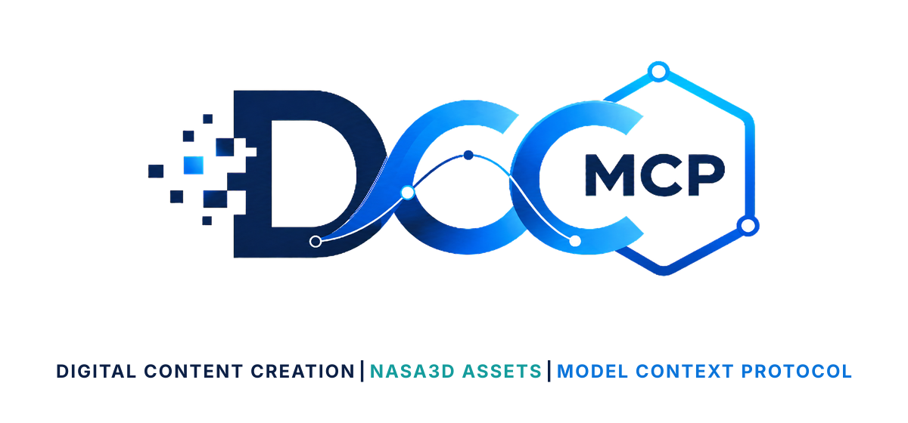
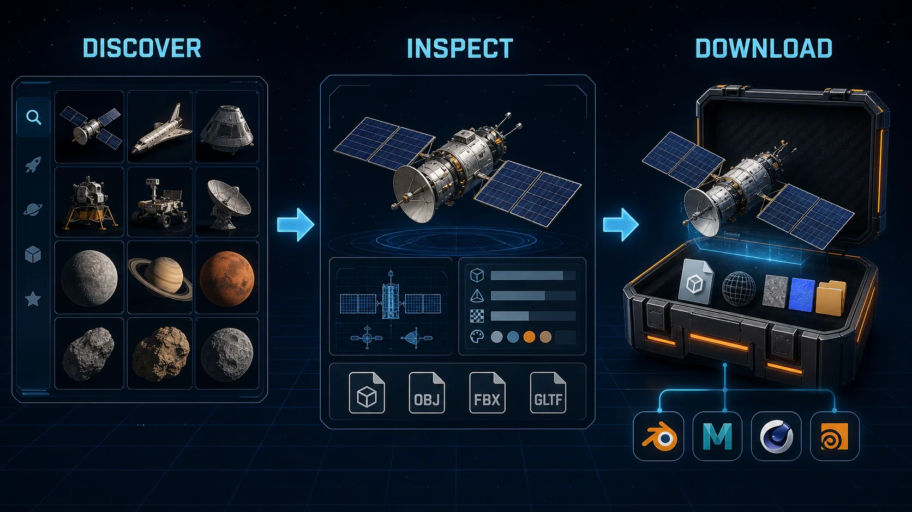

# DCC-MCP NASA 3D Assets

<p align="center">
  
</p>

## Agent workflow

AI agents should use installed package skills through the shared gateway. IDE
users may continue to use the MCP endpoint.

```bash
dcc-mcp-cli dcc-types
dcc-mcp-cli list
dcc-mcp-cli search --query "<task>" --dcc-type <host>
dcc-mcp-cli describe <tool-slug>
dcc-mcp-cli call <tool-slug> --json '{"key":"value"}'
```

If the package skill is not active, call
`dcc-mcp-cli load-skill <skill-name> --dcc-type <host>`. After the task,
query `dcc-mcp-cli stats --range 24h --session-id <task-id>` and pass only
bounded evidence to the `review_skill_improvement` prompt from
`dcc-mcp-skills-creator`.




Search and download files from the public
[NASA-3D-Resources](https://github.com/nasa/NASA-3D-Resources) repository.

## Install

```bash
dcc-mcp-cli marketplace add dcc-mcp/dcc-asset-nasa3d
dcc-mcp-cli marketplace install dcc-asset-nasa3d
```

## License And Usage

NASA's 3D Resources repository says the assets are "free and without
copyright", but NASA insignia, identifiers, and related imagery have separate
brand/media usage rules. Do not imply NASA endorsement and check the official
NASA Images and Media Guidelines before product, advertising, or logo use.

This skill returns `license_name`, `license_url`, and a validated `asset_descriptor` in download
results. The descriptor carries the local path, source URL, and usage attribution for a DCC
adapter import skill.

## Tools

- `search_nasa3d_assets`
- `download_nasa3d_file`
